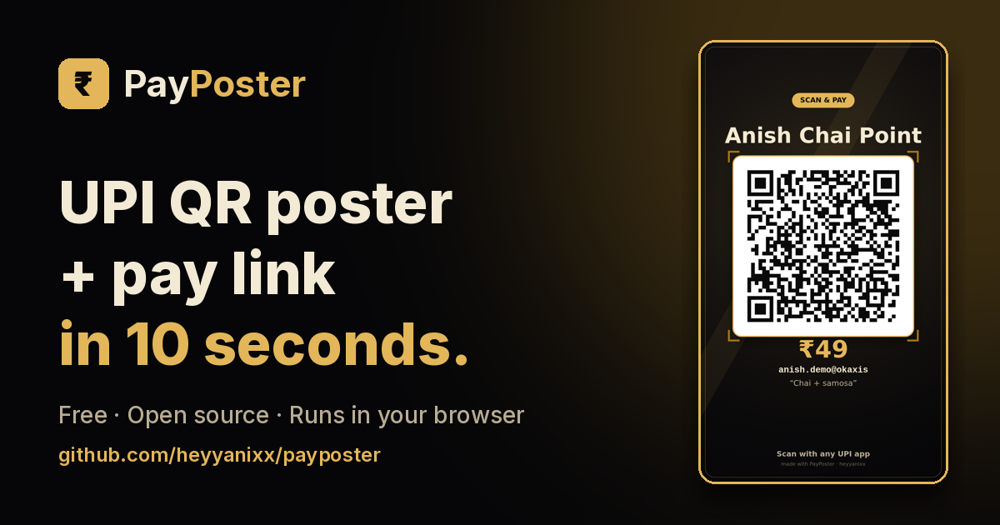

<!--
  HEYYANIXX GitHub profile README · updated 1 Nov 2026
  Art in ./assets is original. Badges: shields.io (static) + komarev profile views.
-->

<h3>
<a href="https://heyyanixx.sites.tab.bot/">Portfolio</a> ·
<a href="https://heyyanixx-tools.sites.tab.bot/">Free Tools</a> ·
<a href="https://heyyanixx-learn.sites.tab.bot/">Learn Arcade</a> ·
<a href="./blog/2026-11-01-6-free-tools-in-one-week.md">Blog</a>
</h3>

<a href="#-what-i-build">What I build</a> ·
<a href="#-featured-open-source-payposter">Featured</a> ·
<a href="#-build-in-public">Build in public</a> ·
<a href="#-stack">Stack</a> ·
<a href="#-connect">Connect</a>

**Heyy, I'm Anish** 👋 — a first-semester BCA (AI) student from Dumka, Jharkhand. Video editor by day, builder by night.
I make **free tools for Indian students and creators** that run right in the browser — no sign-up, no upload.
*Seekh raha hoon, bana raha hoon, aur sab public me share kar raha hoon.* 🚀

## 🛠 What I build

| Project | What it does |
|---|---|
| 💳 **[PayPoster](https://github.com/heyyanixx/payposter)** · [live](https://heyyanixx-payposter.sites.tab.bot/) | UPI QR poster + shareable pay link in 10 seconds. Open source (MIT). |
| 🧰 **[Full ADCA Tools](https://heyyanixx-tools.sites.tab.bot/)** | Free in-browser Word / Sheets / Slides / PDF toolkit, OCR, image & video tools. Nothing uploaded. |
| 📝 **[Notes AI](https://heyyanixx-notes.sites.tab.bot/)** | Notes ka tension khatam — ready exam notes + transcript/photo → short notes, flashcards, quiz. |
| 🎮 **[Learn Arcade](https://heyyanixx-learn.sites.tab.bot/)** | Learning games: typing, commerce/GST, Sarkari GK, video-editing zone. |
| 📱 **[HEYYANIXX App](https://github.com/heyyanixx/heyyanixx-app)** · [APK](https://github.com/heyyanixx/heyyanixx-app/releases/latest) | Android app + PWA that opens everything in one place, with offline games. |
| 🎬 **[Portfolio](https://heyyanixx.sites.tab.bot/)** | My video editing & AI visuals work, AI prompt library and a mini arcade. |

## ⭐ Featured open source: PayPoster

<a href="https://heyyanixx-payposter.sites.tab.bot/"><b>Try it live</b></a> ·
<a href="https://github.com/heyyanixx/payposter"><b>Source code</b></a> ·
<a href="https://github.com/heyyanixx/payposter#contributing"><b>Good first PR: add a poster style</b></a>

## 🔨 Build in public

> Honest log. Small steps, shipped publicly. (AI is my pair programmer — I pick the problems, test everything on my phone and decide what ships.)

- **1 Nov 2026** — Open-sourced **[PayPoster](https://github.com/heyyanixx/payposter)** (v1.0.0) and wrote my first blog post: **[6 free tools in one week](./blog/2026-11-01-6-free-tools-in-one-week.md)**
- **Oct 31 – Nov 1** — Launched **[Notes AI](https://heyyanixx-notes.sites.tab.bot/)** and **[Full ADCA Tools](https://heyyanixx-tools.sites.tab.bot/)**
- **Oct 2026** — Shipped the **[HEYYANIXX app](https://github.com/heyyanixx/heyyanixx-app)**, **[Learn Arcade](https://heyyanixx-learn.sites.tab.bot/)** and my **[portfolio](https://heyyanixx.sites.tab.bot/)**
- **Oct 2026** — Started BCA (AI) at VGU Online · learning C from zero
- **Next** → more PayPoster styles · C lab programs · a reel for every tool

## 🧠 Stack

  <picture>
    <source media="(prefers-color-scheme: dark)" srcset="https://raw.githubusercontent.com/heyyanixx/heyyanixx/output/github-snake-dark.svg" />
    <source media="(prefers-color-scheme: light)" srcset="https://raw.githubusercontent.com/heyyanixx/heyyanixx/output/github-snake.svg" />
    
  </picture>

## 🤝 Connect

  
  
  

Editing reels by day, building free tools by night · learning in public since Oct 2026 · ⭐ a repo if it helped you

